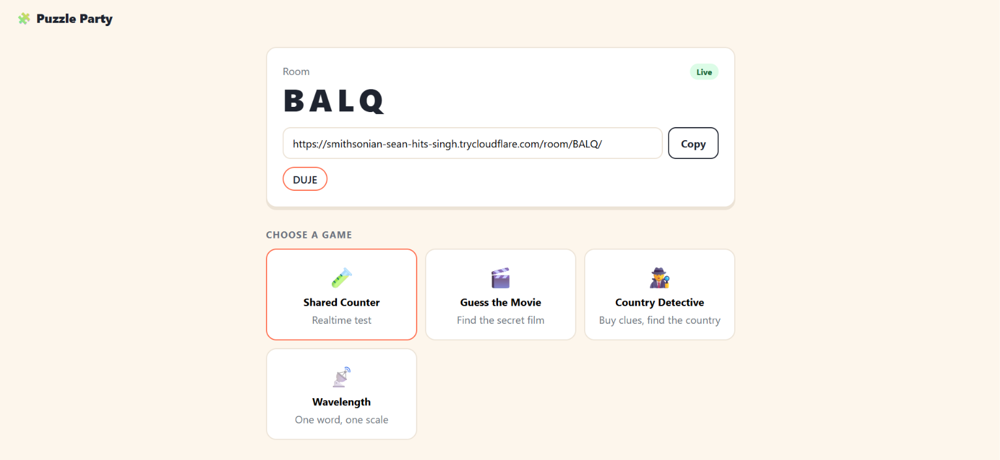

# Puzzle Party 🧩

Real-time multiplayer party games in the browser. Create a room, share the link, pick a
nickname and play. No accounts and no installs for players.

<!-- Add a screenshot or short GIF of a game in progress: docs/screenshots/game.gif -->


## Games

| Game | Idea |
|---|---|
| 🎬 **Guess the Movie** | Find the secret film. Each guess is compared with it (year, runtime, genres, cast, language) and gives hints. Data from TMDB. |
| 🕵️ **Country Detective** | Buy clues from your own budget and be the first to name the country. Each player sees only the clues they bought. |
| 📡 **Wavelength** | One player sees a secret spot on a scale between two opposites and gives a one-word clue. The others guess where it is. |

## How it works

- **Django Channels and WebSockets** keep everyone in a room in sync in real time.
- **Per-player state:** the server holds the full game state, secrets included, and
  sends each player only what they are allowed to see. This makes hidden-information
  games like Country Detective possible.
- **Pluggable games:** every game implements the same small interface and registers
  itself, so a new game doesn't touch the rooms or networking code.

```python
@register_game
class MyGame(GameMode):
    def create_state(self): ...                         # start a round (may hold secrets)
    def handle_action(self, state, action, player): ... # apply a player's move
    def get_public_state(self, state, viewer): ...      # what this player can see
```

## Tech stack

Python · Django · Django Channels · WebSockets · JavaScript · SQLite · Cloudflare Tunnel

## Running locally

Requires Python 3.12+.

```bash
pip install -r requirements.txt
cp .env.example .env          # set DJANGO_SECRET_KEY and TMDB_READ_TOKEN
python manage.py migrate
python manage.py sync_countries
python manage.py sync_movies
python manage.py runserver
```

To play with friends over the internet, `python play.py` starts the server together with
a free Cloudflare tunnel and copies the public link to your clipboard (needs
`cloudflared`, and `.trycloudflare.com` allowed in `.env`, see `.env.example`).

## Author

**Duje Troskot**, MSc Computing (Data Science) student at FER, University of Zagreb
